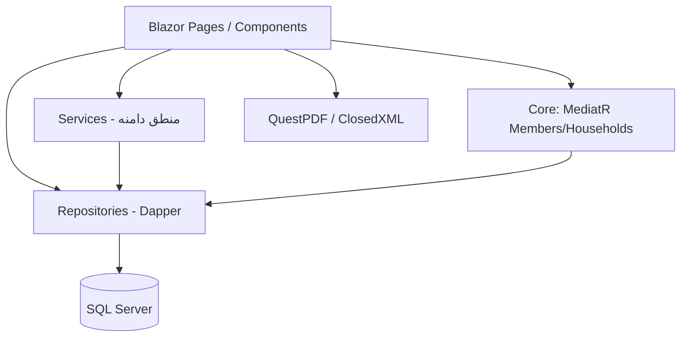
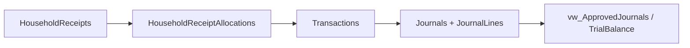
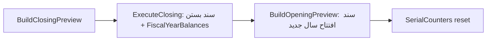

# ایندکس جامع پروژه MiniBank — صندوق همیاری امام علی (ع)

> تاریخ تهیه: ۲۰۲۶-۱۰-۲۳ · وضعیت Build: موفق (`0 Error` / `103 Warning`) · Branch: `master`

این سند نقشه‌ی کامل مخزن است: معماری، ماژول‌ها، مسیرها، سرویس‌ها، ریپازیتوری‌ها، مدل داده و نتایج بازبینی. برای پیدا کردن سریع «هر چیز کجاست» از این فایل شروع کنید.

---

## ۱. شناسنامه پروژه

| مورد | مقدار |
|---|---|
| نام تجاری | صندوق همیاری امام علی (ع) — EAFund / MiniBank |
| پروژه اجرایی | `src/MiniBank.Web/MiniBank.Web.csproj` |
| نوع اپلیکیشن | Blazor Server (Interactive Server) + Minimal APIs |
| فریم‌ورک | .NET 8 (`net8.0`) — با SDK 9.0.102 ساخته می‌شود |
| پایگاه داده | SQL Server — دسترسی با Dapper (بدون EF Core) |
| UI | MudBlazor 6.11.2 + Design System اختصاصی (`Ds*`) |
| احراز هویت | Cookie Authentication + مجوز صفحه‌ای بر اساس نقش |
| گزارش‌ها | QuestPDF (PDF) + ClosedXML (Excel) |
| PWA | manifest + service worker + صفحه offline + splash |
| زبان/تقویم | فارسی، RTL، `fa-IR` با `PersianCalendar` |
| حجم کد | ۱۷۵ فایل C# (~۲۴٬۴۰۰ خط) و ۱۱۴ فایل Razor (~۵۶٬۴۰۰ خط) |
| مسیرها | حدود ۷۵ مسیر `@page` |
| تست | ۳ فایل تست xUnit (پروژه تست در Solution ثبت نشده) |

---

## ۲. ساختار مخزن

```
Emam_Ali_Sandogh_New/
├── src/
│   ├── MiniBank.Web/              ← اپلیکیشن اصلی
│   │   ├── Program.cs             ← نقطه شروع، DI، Endpointها، Migration
│   │   ├── App.razor              ← Router + AuthGuardRouteView + ErrorBoundary
│   │   ├── Pages/                 ← صفحات Blazor (Admin / Me / Auth / Errors)
│   │   ├── Shared/                ← Layoutها و کامپوننت‌های دسترسی
│   │   ├── Components/            ← Design System، منو، تاریخ شمسی، PWA
│   │   ├── Core/                  ← CQRS سبک (Commands/Queries/Handlers/Validators)
│   │   ├── Infrastructure/        ← DbConnectionFactory + Repositories + UnitOfWork
│   │   ├── Services/              ← منطق دامنه (حسابداری، وام، سپرده، مالی، پیامک)
│   │   ├── Models/                ← موجودیت‌ها و DTOها
│   │   ├── Reports/               ← تولید PDF با QuestPDF
│   │   ├── Middleware/            ← GlobalExceptionMiddleware
│   │   ├── Utilities/             ← تاریخ، سند افتتاحیه
│   │   ├── Validators/            ← FluentValidation رسیدها
│   │   └── wwwroot/               ← CSS/JS/PWA/فونت/آیکون
│   └── MiniBank.Web.Tests/        ← تست‌های xUnit (خارج از Solution)
├── database/
│   ├── schema.sql                 ← اسکیمای واحد و idempotent (منبع اصلی)
│   ├── 01_flexible_account_codes.sql
│   ├── 02_safe_transaction_management.sql
│   ├── 03_comprehensive_audit_trail.sql
│   └── migrations/004_journal_status_lifecycle.sql
├── ConstraintFix/                 ← ابزار کنسول یک‌بارمصرف (خارج از Solution)
├── TestDbConnection/, TestTrialBalanceQueries/  ← ابزارهای تست دستی
├── fix_*.sql, cleanup_tables_manual.sql        ← اسکریپت‌های اصلاح یک‌بارمصرف
├── start-minibank.bat / kill-minibank.bat
├── MiniBank.sln                   ← فقط پروژه Web
└── README.md                      ← توضیح رفتار استاندارد سپرده‌ها
```

---

## ۳. پشته فناوری (NuGet)

| پکیج | نسخه | کاربرد |
|---|---|---|
| `Microsoft.Data.SqlClient` | 5.2.1 | اتصال SQL Server |
| `Dapper` | 2.1.66 | Micro-ORM تمام کوئری‌ها |
| `MudBlazor` | 6.11.2 | کامپوننت‌های پایه UI |
| `MediatR` | 12.2.0 | CQRS محدود به Members/Households |
| `FluentValidation.AspNetCore` | 11.3.0 | اعتبارسنجی رسید و خانوار |
| `Serilog.AspNetCore` + `Sinks.File` | 8.0.0 / 5.0.0 | لاگ ساختاریافته در `logs/` |
| `QuestPDF` | 2024.6.0 | گزارش‌های PDF |
| `ClosedXML` | 0.102.2 | خروجی Excel |
| `Microsoft.Extensions.Caching.Memory` | 8.0.1 | کش (`CacheService`) |
| `Microsoft.Extensions.Caching.StackExchangeRedis` | 8.0.0 | نصب شده ولی در DI استفاده نشده |
| `Microsoft.AspNetCore.Authentication.JwtBearer` | 8.0.1 | نصب شده ولی احراز هویت Cookie است |
| `System.IdentityModel.Tokens.Jwt` | 8.2.0 | بدون استفاده فعال |
| `xunit` + `Moq` + `FluentAssertions` | — | پروژه تست |

---

## ۴. معماری و چرخه شروع

### لایه‌ها



- **UI:** Blazor Server؛ هر صفحه معمولاً یک فایل `.razor` بزرگ با منطق inline و `@inject` ریپازیتوری/سرویس.
- **Services:** منطق کسب‌وکار (ثبت سند، سود سپرده، وام، سال مالی، پیامک).
- **Repositories:** همه با Dapper و SQL دستی؛ `BaseRepository` + `IDbConnection`/`IDbConnectionFactory`.
- **Core/CQRS:** فقط برای `Members` و `Households` پیاده‌سازی شده (MediatR + FluentValidation).
- **Minimal APIs:** در `Program.cs` برای گزارش‌ها، رسیدها، لاگین و ابزارها.

### ترتیب راه‌اندازی (`Program.cs`)

1. پیکربندی Serilog (کنسول + فایل روزانه `logs/minibank-.txt`، نگهداری ۳۰ روز).
2. ثبت Razor Pages، SignalR (تایم‌اوت ۵ دقیقه، پیام ۶۴KB)، Blazor Server، MudBlazor.
3. ثبت MediatR، FluentValidation، MemoryCache.
4. ثبت `IDbConnection` (SqlConnection با Lazy Open) و `IDbConnectionFactory`.
5. ثبت ~۳۵ ریپازیتوری و ~۳۰ سرویس + `OnlineUsersTracker` + CircuitHandler.
6. Hosted Services: `WarmupService` (گرم‌کردن اولیه) و `DbBackupHostedService` (پشتیبان‌گیری زمان‌بندی‌شده).
7. Data Protection Keys روی دیسک (`DataProtection:KeyPath` یا `%ProgramData%\MiniBank\DataProtectionKeys`).
8. Cookie Auth (۳۰ روز، Sliding) + `FallbackPolicy = RequireAuthenticatedUser`.
9. Culture فارسی + `PersianCalendar` + لایسنس Community برای QuestPDF.
10. اجرای Migration در صورت `Database:RunMigrationsOnStartup=true` (پیش‌فرض `false`).
11. Seed صفحات مجوز از روی `@page`ها + ساخت کاربر Admin اولیه از `Auth:SeedAdmin`.
12. Pipeline: `GlobalExceptionMiddleware` → HSTS/HTTPS (Production) → StaticFiles → Routing → Auth → Redirect ریشه → Endpoints.
13. ریشه `/` بر اساس نقش: ناشناس → `/login`، Member → `/dashboard`، سایر → `/admin/dashboard2`.

> نکته: `app.MapBlazorHub()` و `MapFallbackToPage("/_Host")` به‌صورت `AllowAnonymous` ثبت شده‌اند؛ محافظت صفحات در سمت کلاینت با `AuthGuardRouteView` انجام می‌شود و Endpointهای Minimal API توسط FallbackPolicy محافظت می‌شوند.

---

## ۵. احراز هویت و مجوزها

| موضوع | پیاده‌سازی |
|---|---|
| Scheme | Cookie (`CookieAuthenticationDefaults`) |
| ورود API | `POST /api/auth/login` (JSON) و `POST /auth/login` (Form) |
| خروج | `POST /api/auth/logout` و `GET /logout` |
| تغییر رمز | `POST /api/auth/change-password` |
| نقش‌ها | `Admin` و `Member` (سیستمی) + نقش‌های سفارشی در `AuthRoles` |
| مجوز | جدول `AuthPages` + `AuthRolePagePermissions` (دسترسی نقش به مسیر) |
| Seed صفحات | `AuthPageSeeder` مسیرهای `@page` را از فایل‌های Razor و Reflection استخراج و Upsert می‌کند |
| محافظت UI | `Shared/AuthGuardRouteView.razor` + `PermittedContent` / `PermittedAnyContent` |
| ورود اعضا | نام کاربری = کد ملی؛ رمز اولیه = ۴ رقم آخر کد ملی (ساخت خودکار کاربر Member) |
| Seed ادمین | `Auth:SeedAdmin:Username/Password` در `appsettings.json` |

نکته امنیتی مهم: رمزها در ستون `AuthUsers.PasswordEnc` **به‌صورت متن ساده** ذخیره می‌شوند و نسخه رمزنگاری‌شده (DPAPI) در `PasswordViewEnc` نگهداری می‌شود. مسیر PBKDF2 فقط برای سازگاری خوانده می‌شود. جزئیات در بخش ۱۵.

---

## ۶. ماژول‌های دامنه

### ۶.۱ اعضا و خانوار
- مدل: `Member`, `Household`؛ رابطه با `HouseholdCode` (نه شناسه).
- CQRS: `Core/Commands`, `Core/Queries`, `Core/Handlers`, `Core/Validators`.
- سرویس‌ها: `MemberService`, `HouseholdService`, `MemberFinancialSnapshotService`.
- صفحات: `/admin/members`, `/admin/households` + شیت‌های `MemberIOSSheet`, `HouseholdIOSSheet`, `HouseholdEditDialog`, `HouseholdSheet`.
- پورتال عضو: `/dashboard`, `/me/profile`, `/me/household`, `/me/loans`, `/me/transactions`.

### ۶.۲ حسابداری و دفتر کل
- ساختار ۴ سطحی حساب: `1=گروه`, `2=کل`, `3=معین`, `4=تفضیلی` (`Account.Level`).
- انواع حساب: دارایی/بدهی/حقوق صاحبان/درآمد/هزینه (`Account.AccountType`).
- اسناد: `Journals` + `JournalLines`؛ وضعیت سند `1=موقت`, `2=دائمی`, `3=قطعی` + `IsDeleted` + `SerialNumber` + `DocumentNumber`.
- قواعد: تریگر `TR_Journals_EnforceBalance` (توزان بدهکار/بستانکار) و `TR_Journals_SetFiscalYear`.
- الگوهای ثبت: `PostingTemplates` + `PostingTemplateLines` (منبع مبلغ، سمت بدهکار/بستانکار، بُعد عضو).
- سرویس‌ها: `AccountingPostingService` (تولید سند از تراکنش)، `PostingService` (سند دستی/ساده)، `ProfitLossService`.
- صفحات: `kol`, `moeen`, `subsidiary`, `account-types`, `accounts`, `accounting/accounts`, `posting-templates`, `accounting/profit-loss`, `manual-journal-entry` (v1) و `manual-journal-entry-v2` (+ history).

### ۶.۳ تراکنش‌ها و رسید خانوار
- جریان: `HouseholdReceipts` (سربرگ) → `HouseholdReceiptAllocations` (تسهیم بین اعضا) → `Transactions` (هر تخصیص) → `Journals` (ثبت دوطرفه).
- فیلدهای تفصیلی تراکنش: اصل، سود، جریمه، کارمزد، مالیات + `ParentReceiptId` + `AllocationId` + `IdempotencyKey`.
- `SafeTransactionService`: استفاده از `ProcessLog` و `FailedTransactions` برای ردیابی و Rollback.
- ویرایش/حذف سند: `JournalsRepository`, `JournalLinesRepository`؛ حذف آبشاری رسید در `DELETE /api/receipts/household/{id}?cascade=true`.
- اعتبارسنجی: `Validators/HouseholdReceiptValidator.cs`, `HouseholdReceiptAllocationValidator.cs`.

### ۶.۴ وام‌ها
- مدل/وضعیت: `Draft=1, Approved=2, Disbursed=3, Active=4, Settled=5, Cancelled=6`.
- جداول: `Loans`, `LoanInstallments`, `LoanPayments`, `LoanPaymentAllocations`, `LoanGuarantees`, `LoanRatePlans`, `CreditHolds`.
- محاسبات: `LoanCalculatorService.GenerateSchedule` (EMI، سود، جریمه)، `LoanService`, `LoanRateService`.
- ضمانت/مسدودی: `CreditHolds` با `LockPercent` و نقش ضامن/وام‌گیرنده.
- صفحات: `/admin/loans` + `LoanCreateInline`, `LoanIOSSheet`, `/admin/loan-rates`, `/admin/loan-installment-reminders`, گزارش `/admin/reports/loans` (PDF/Excel).

### ۶.۵ سپرده‌ها و سود
- دو نسل موازی:
  - **جدید:** `DepositRatePlans` + `DepositRateTiers` (نرخ ساده/پله‌ای) + `DepositTypes.razor` و `DepositRatePlanIOSSheet`.
  - **قدیمی/مرده:** `DepositTypeService`, `DepositTypeIOSSheet`, `DepositRateIOSheet` (بدون ارجاع و بدون ثبت در DI).
- محاسبه سود: `DepositInterestPostingService` → `DepositInterestRuns` + `DepositInterestRunItems` با ثبت سند حسابداری.
- استانداردها: `Models/DepositStandards.cs` (AccrualBasis, PostingFrequency, Compounding, DayCountConvention، RoundingRule، TaxRate، MinBalance).
- صفحات: `/admin/deposit-types`, `/admin/deposit-accounts/open`, `/admin/deposit-interest-calc`.

### ۶.۶ سال مالی
- جدول `FiscalYears` + `FiscalYearBalances` + `SerialCounters` (شماره اسناد).
- `FiscalYearService`: بستن سال (`ExecuteClosingAsync`)، پیش‌نمایش، افتتاح سال جدید (`BuildOpeningPreviewAsync`)، برگشت بستن (`RevertClosingAsync`).
- `FiscalYearContext` و `FiscalYearRangeProvider` دامنه تاریخ گزارش‌ها را تعیین می‌کنند؛ `FiscalYearBadge` نمایش وضعیت.
- صفحات: `/admin/fiscal-years`, `/admin/fiscal-years/closing/{id}`, `/admin/fiscal-years/opening/{source}/{target}`.

### ۶.۷ گزارش‌ها
| گزارش | مسیر | منبع |
|---|---|---|
| تراز آزمایشی تعاملی | `/admin/reports/trial-balance` | `TrialBalanceRepository`, `vw_TrialBalance` |
| ترازنامه | `/admin/reports/balance-sheet` | `sp_BalanceSheet_AsOf`, `BalanceSheetSnapshot` |
| صورت‌های مالی | `/admin/reports/financial-statements` | `AccountingReportRepository` |
| خلاصه/تفصیلی تراکنش | `/admin/reports/tx-summary`, `/transactions` | `TransactionReportRepository` |
| گزارش بانکی اعضا | `/admin/reports/member-banking` | `Models/Reports/MemberBankingReportModels` |
| وام‌ها | `/admin/reports/loans` | `LoanReportsRepository` + `LoansInstallmentsReport` (PDF/Excel) |
| تفضیلی/معین | `/admin/reports/tafsili-moeen/{id}`, `/subsidiary-transactions/{id}` | `AccountingReportRepository` |
| سهام واتساپ | `/admin/reports/whatsapp-shares` | صفحه مستقل |
| نهایی‌سازی اسناد | `/admin/reports/finalize-journals` | `JournalsRepository` |

APIها: `GET /api/reports/trial-balance`, `GET /api/reports/balance-sheet`, `GET /api/reports/tx/summary`, `GET /api/reports/loans/pdf`, `GET /api/reports/loans/excel`.

### ۶.۸ پیامک (SmsIr)
- سرویس‌ها: `SmsSender` (Verify/Parameters/Status)، `SmsSendService` (کسر اعتبار).
- جداول: `SmsSettings`, `SmsFeatures`, `SmsTemplates`, `SmsCreditTopups`, `SmsMessageLogs`.
- صفحات: `/admin/sms`, `/admin/sms-panel`, `/admin/sms-reports`.

### ۶.۹ پشتیبان‌گیری
- `DbBackupService` + `DbBackupRepository` + `DbBackupHostedService` (زمان‌بندی) + `/admin/db-backups` + دانلود امن `GET /api/admin/db-backups/{runId}/download`.

### ۶.۱۰ سایر
- **کاربران آنلاین:** `OnlineUsersTracker` (Singleton) + `OnlineUsersCircuitHandler` + `/admin/online-users`.
- **بودجه نقدینگی:** `CashFlowBudgetRepository` + `/admin/cashflow-budget` (جدول `CashFlowBudgetItems`).
- **تنظیمات:** `/admin/settings` (مدل `SiteSettings`).
- **پروفایل مدیر:** `/admin/my-profile` (`/me/profile` برای عضو).
- **Design System Demo:** `/admin/design-system-demo`.

---

## ۷. فهرست مسیرها (Route Index)

### عمومی و پورتال عضو
| مسیر | فایل |
|---|---|
| `/` | `Pages/_Host.cshtml` (+ Redirect در `Program.cs`) |
| `/login` | `Pages/Auth/Login.razor` |
| `/forbidden` | `Pages/Errors/Forbidden.razor` |
| `/dashboard` | `Pages/Dashboard.razor` |
| `/me/profile` | `Pages/Me/Profile.razor` |
| `/me/household` | `Pages/Me/Household.razor` |
| `/me/loans` | `Pages/Me/Loans.razor` |
| `/me/transactions` | `Pages/Me/Transactions.razor` |

### اعضا، خانوار و حساب‌ها
| مسیر | فایل |
|---|---|
| `/admin/members` | `Pages/Admin/Members/Members.razor` |
| `/admin/households` | `Pages/Admin/Households/Households.razor` |
| `/admin/account-types` | `Pages/Admin/AccountTypes/AccountTypes.razor` |
| `/admin/kol` | `Pages/Admin/Kol/Kol.razor` |
| `/admin/moeen` | `Pages/Admin/Moeen/Moeen.razor` |
| `/admin/subsidiary` | `Pages/Admin/Subsidiary/Subsidiary.razor` |
| `/admin/accounts` | `Pages/Admin/Accounts/Accounts.razor` |
| `/admin/accounting/accounts` | `Pages/Admin/Accounting/Accounts.razor` |

### حسابداری و اسناد
| مسیر | فایل |
|---|---|
| `/admin/posting-templates` | `Pages/Admin/Accounting/PostingTemplates.razor` |
| `/admin/accounting/profit-loss` | `Pages/Admin/Accounting/ProfitLossClosing.razor` |
| `/admin/manual-journal-entry` | `Pages/Admin/ManualJournalEntry/ManualJournalEntry.razor` |
| `/admin/manual-journal-entry-v2` | `Pages/Admin/ManualJournalEntry/ManualJournalEntryV2.razor` |
| `/admin/manual-journal-entry-v2/history` | همان فایل |
| `/admin/fiscal-years` | `Pages/Admin/FiscalYears/FiscalYears.razor` |
| `/admin/fiscal-years/closing/{FiscalYearId:int}` | `FiscalYearClosing.razor` |
| `/admin/fiscal-years/opening/{SourceYearId:int}/{TargetYearCode:int}` | `FiscalYearOpening.razor` |

### وام و سپرده
| مسیر | فایل |
|---|---|
| `/admin/loans` | `Pages/Admin/Loans/Loans.razor` |
| `/admin/loan-rates` | `Pages/Admin/LoanRates/LoanRates.razor` |
| `/admin/loan-installment-reminders` | `Pages/Admin/Loans/LoanInstallmentReminders.razor` |
| `/admin/deposit-types` | `Pages/Admin/DepositTypes/DepositTypes.razor` |
| `/admin/deposit-accounts/open` | `Pages/Admin/DepositAccounts/Open.razor` |
| `/admin/deposit-interest-calc` | `Pages/Admin/DepositInterestCalc/DepositInterestCalc.razor` |

### گزارش‌ها
| مسیر | فایل |
|---|---|
| `/admin/reports/trial-balance` | `Reports/InteractiveTrialBalance.razor` |
| `/admin/reports/balance-sheet` | `Reports/BalanceSheet.razor` |
| `/admin/reports/financial-statements` | `Reports/FinancialStatements.razor` |
| `/admin/reports/tx-summary` | `Reports/TxSummary.razor` |
| `/admin/reports/transactions` | `Reports/TransactionReports.razor` |
| `/admin/reports/member-banking` | `Reports/MemberBankingReports.razor` |
| `/admin/reports/loans` | `Reports/LoansReport.razor` |
| `/admin/reports/tafsili-moeen/{TafsiliAccountId:long}` | `Reports/TafsiliMoeenReport.razor` |
| `/admin/reports/subsidiary-transactions/{AccountId:long}` | `Reports/SubsidiaryTransactions.razor` |
| `/admin/reports/whatsapp-shares` | `Reports/WhatsAppSharesReport.razor` |
| `/admin/reports/finalize-journals` | `Reports/FinalizeJournals.razor` |

### سیستم و مدیریت
| مسیر | فایل |
|---|---|
| `/admin/dashboard` | `Pages/Admin/Dashboard/Index.razor` |
| `/admin/dashboard2` | `Pages/Admin/Dashboard/Dashboard2.razor` (**داشبورد اصلی**) |
| `/admin/auth/users` | `Pages/Admin/Auth/Users.razor` |
| `/admin/auth/roles` | `Pages/Admin/Auth/Roles.razor` |
| `/admin/settings` | `Pages/Admin/Settings.razor` |
| `/admin/my-profile` | `Pages/Admin/MyProfile.razor` |
| `/admin/online-users` | `Pages/Admin/OnlineUsers.razor` |
| `/admin/db-backups` | `Pages/Admin/DbBackups.razor` |
| `/admin/cashflow-budget` | `Pages/Admin/CashFlowBudget.razor` |
| `/admin/sms` | `Pages/Admin/Sms.razor` |
| `/admin/sms-panel` | `Pages/Admin/SmsPanel.razor` |
| `/admin/sms-reports` | `Pages/Admin/SmsReports.razor` |
| `/admin/design-system-demo` | `Pages/Admin/DesignSystemDemo.razor` |

> دو فایل `Pages/Admin/Receipts/HouseholdReceiptWizardV2.razor` و `Pages/Admin/PaymentTransactions/PaymentTransactions.razor` در `.csproj` از Build حذف شده‌اند و در زمان اجرا مسیر ندارند.

---

## ۸. سرویس‌ها (`src/MiniBank.Web/Services`)

| سرویس | مسئولیت |
|---|---|
| `AccountingPostingService` | ساخت خطوط سند از الگوی ثبت برای هر تراکنش + پیش‌نمایش |
| `PostingService` | ساخت سند ساده/دستی، افزودن خط، اعتبارسنجی و نهایی‌سازی |
| `SafeTransactionService` | ProcessLog/FailedTransactions، ثبت گام‌ها و Rollback |
| `DepositInterestPostingService` | اجرای محاسبه/ثبت سود سپرده و ثبت سند |
| `DepositRateService` | نرخ‌های پله‌ای سپرده و انتخاب نرخ معتبر در تاریخ |
| `DepositTypeService` | CRUD انواع سپرده (قدیمی — در DI ثبت نشده) |
| `FiscalYearService` | بستن/افتتاح/برگشت سال مالی، پیش‌نمایش، گردش حساب |
| `FiscalYearContext` / `FiscalYearRangeProvider` | سال مالی جاری و بازه گزارش |
| `LoanCalculatorService` | جدول اقساط EMI، سود و جریمه |
| `LoanService` / `LoanRateService` | عملیات وام و نرخ‌ها |
| `MemberService` / `HouseholdService` | عملیات اعضا/خانوار |
| `MemberFinancialSnapshotService` | مانده سرمایه، سود، مسدودی و سرمایه آزاد عضو |
| `BankAccountService` | حساب‌های بانکی صندوق |
| `ProfitLossService` | بستن حساب‌های سود و زیان |
| `TransactionPresentationService` | آماده‌سازی نمایش تراکنش‌ها |
| `ReceiptDataService` | داده‌های رسید خانوار |
| `SmsSender` / `SmsSendService` | ارسال پیامک SmsIr و کسر اعتبار |
| `CacheService` | کش حافظه‌ای |
| `DatabaseMigrationService` | اجرای `database/schema.sql` با هش و چند Pass |
| `DatabaseInitializationService` | اسکریپت‌های تکمیلی (استفاده نمی‌شود) |
| `DbBackupService` / `DbBackupHostedService` | پشتیبان‌گیری و زمان‌بندی |
| `LoadingService` | Overlay بارگذاری |
| `WarmupService` | گرم‌کردن اولیه اپ |
| `OnlineUsersTracker` / `OnlineUsersCircuitHandler` | حضور کاربران |
| `CustomerService` / `ReceiptWizardService` | بقایای نسخه قبلی (بدون استفاده/خارج از Build) |
| `Services/Auth/*` | `AuthService`, `AuthPermissionService`, `AuthPageSeeder`, `AuthSyncService`, `AuthActivityService`, `CryptoService`, `PasswordHashService` |

---

## ۹. ریپازیتوری‌ها (`Infrastructure/Repositories`)

| گروه | ریپازیتوری‌ها |
|---|---|
| پایه | `BaseRepository`, `UnitOfWork`, `DbConnectionFactory` |
| اعضا/خانوار | `HouseholdRepository`, `MemberRepository` |
| حسابداری | `AccountsRepository`, `AccountTypeRepository`, `PostingTemplateRepository`, `JournalsRepository`, `JournalLinesRepository`, `TrialBalanceRepository`, `AccountingReportRepository`, `AuditRepository`, `TransactionAuditRepository` |
| تراکنش/رسید | `TransactionRepository`, `TransactionReportRepository`, `HouseholdReceiptRepository`, `HouseholdReceiptAllocationRepository` |
| وام | `LoanRepository`, `LoanInstallmentRepository`, `LoanPaymentRepository`, `LoanGuaranteeRepository`, `LoanRatePlanRepository`, `CreditHoldRepository`, `LoanReportsRepository`, `LoanInstallmentReminderRepository` |
| سپرده | `DepositRatePlanRepository`, `DepositRateTierRepository`, `DepositInterestRunRepository`, `DepositTypeRepository`, `DepositInterestRateRepository`, `MemberDepositAccountRepository` |
| مالی/سیستم | `FiscalYearRepository`, `CashFlowBudgetRepository`, `BankAccountRepository` |
| احراز هویت | `AuthRepository` |
| پیامک | `SmsPanelRepository`, `SmsMessageLogRepository` |
| پشتیبان | `DbBackupRepository` |

---

## ۱۰. مدل‌ها (`src/MiniBank.Web/Models`)

- **اعضا:** `Member`, `Household`
- **حسابداری:** `Account`, `AccountType`, `Journal`, `JournalLine`, `JournalLineDetail`, `JournalLinePreview`, `PostingTemplate`, `PostingTemplateLine`, `PostingTemplateDto`, `TrialBalanceRow`, `TrialBalanceNode`, `BalanceSheetSnapshot`
- **تراکنش/رسید:** `Transaction`, `TransactionSummaryRow`, `TransactionAuditEntry`, `HouseholdReceipt`, `HouseholdReceiptAllocation`, `PendingReceiptSummary`, `ProcessedReceiptSummary`, `ReceiptDeletionInfo`
- **وام:** `Loan`, `LoanInstallment`, `LoanGuarantee`, `LoanRatePlan`, `CreditHold`
- **سپرده:** `DepositType`, `DepositRatePlan`, `DepositRateTier`, `DepositInterestRate`, `DepositInterestRun`, `DepositInterestRunItem`, `MemberDepositAccount`, `DepositStandards`, `MemberFinancialSnapshot`
- **مالی:** `FiscalYear`, `FiscalYearBalance`, `SerialCounter`, `CashFlowBudgetItem`, `SiteSettings`
- **سیستم:** `BankAccount`, `PreviewRequest`, `PreviewTemplateRequest`, `CustomerDto`
- **Auth:** `AuthUser`, `AuthRole`, `AuthPage`, `AuthRolePagePermission`
- **گزارش:** `Models/Reports/*`, `Models/Sms/*`, `Models/Admin/DbBackupModels.cs`

---

## ۱۱. پایگاه داده

### مدیریت Migration
- سرویس: `DatabaseMigrationService.ApplyMigrationsAsync()`.
- اگر `database/schema.sql` وجود داشته باشد **فقط همان** اجرا می‌شود؛ در غیر این صورت فایل‌های `NNN_*.sql` به ترتیب.
- ثبت هش فایل در `dbo.__SchemaMigrations`؛ فایل تغییرنکرده رد می‌شود.
- اجرای Batch شکسته‌شده با `GO`، حداکثر ۸ Pass برای رفع وابستگی‌ها.
- `Database:RunMigrationsOnStartup` در `appsettings.json` روی `false` است.

### جداول اصلی (۳۶ جدول در `schema.sql`)

| دامنه | جداول |
|---|---|
| اعضا | `Households`, `Members` |
| حساب‌ها | `Accounts`, `AccountTypes` |
| تراکنش | `Transactions`, `TransactionAudits` |
| رسید | `HouseholdReceipts`, `HouseholdReceiptAllocations` |
| سند | `Journals`, `JournalLines` |
| الگو | `PostingTemplates`, `PostingTemplateLines` |
| وام | `Loans`, `LoanInstallments`, `LoanPayments`, `LoanPaymentAllocations`, `LoanGuarantees`, `LoanRatePlans`, `CreditHolds` |
| سپرده | `DepositRatePlans`, `DepositRateTiers`, `DepositInterestRuns`, `DepositInterestRunItems` |
| مالی | `FiscalYears`, `FiscalYearBalances`, `SerialCounters` |
| Auth | `AuthUsers`, `AuthRoles`, `AuthPages`, `AuthRolePagePermissions` |
| پیامک | `SmsSettings`, `SmsFeatures`, `SmsTemplates`, `SmsCreditTopups`, `SmsMessageLogs` |
| عملیات | `ProcessLog`, `FailedTransactions`, `AuditTrail`, `BankAccounts` |

### جداول ارجاع‌شده ولی بدون `CREATE TABLE` در مخزن
`DepositTypes`, `DepositInterestRates`, `MemberDepositAccounts`, `SiteSettings`, `CashFlowBudgetItems`, `TransactionTypes` — این جداول باید از قبل در دیتابیس موجود باشند (در `schema.sql` ساخته نمی‌شوند).

### View / Procedure / Trigger
| نام | نوع | کاربرد |
|---|---|---|
| `vw_TrialBalance` | View | تراز آزمایشی |
| `vw_ApprovedJournals` | View | اسناد معتبر (`Status>=2` و `IsDeleted=0`) |
| `vw_JournalLinesFlat` | View | خطوط سند به‌صورت تخت |
| `vw_MemberDepositBalances` | View | مانده سپرده اعضا |
| `sp_BalanceSheet_AsOf` | Procedure | ترازنامه تا تاریخ |
| `TR_Journals_EnforceBalance` | Trigger | الزام توزان سند |
| `TR_Journals_SetFiscalYear` | Trigger | تخصیص خودکار سال مالی |

### اسکریپت‌های تکمیلی
- `database/01_flexible_account_codes.sql` — آزادسازی الگوی کد حساب (شامل `USE [foodir_EmamAli_minibank]`).
- `database/02_safe_transaction_management.sql` — جدول‌های `ProcessLog` و `FailedTransactions`.
- `database/03_comprehensive_audit_trail.sql` — `AuditTrail` و تریگرهای ممیزی.
- `database/migrations/004_journal_status_lifecycle.sql` — Status/IsDeleted/SerialNumber و `vw_ApprovedJournals`.
- `src/MiniBank.Web/Migrations/V005/V006` و `RemoveUnusedBackupColumns.sql` — مایگریشن‌های تاریخی.
- `fix_*.sql` و `cleanup_tables_manual.sql` در ریشه — اسکریپت‌های یک‌بارمصرف.

---

## ۱۲. UI و Design System

### کامپوننت‌های اختصاصی (`Components/DesignSystem`)
`DsButton`, `DsCard`, `DsConfirm`, `DsDateText`, `DsDropdown`, `DsFab`, `DsFabNavigation`, `DsHierarchicalAccountSelector`, `DsInput`, `DsJalaliDatePicker`, `DsMoneyInput`, `DsMultiStepForm`, `DsPageHeader`, `DsPillGroup`, `DsSearchCard`, `DsSheet`, `DsStorybook`, `DsToast`, `DsToastContainer`, `DsToggle` + سرویس `DsToastService`.

### Layout و اجزای عمومی
`MainLayout`, `LoginLayout`, `NavMenu` (منوی قدیمی), `CurvedNavigationBar`, `FooterMaster2`, `FiscalYearBadge`, `PersianDate`, `PersianDatePicker`, `MemberSelector`, `LoadingOverlay`, `InstallPromptDialog`, `OnlinePresencePing`.

### CSS / JS
- CSS: `design-tokens.css`, `site.css`, `components.css`, `loading.css`, `toast-fix.css`, پوشه‌های `tokens/`, `ds/`, `layout/`.
- JS: `navigation.js`, `footer-nav.js`, `app-nav.js`, `persian-datepicker.js`, `normalize-digits.js`, `theme.js`, `app-install.js`, `pwa-splash.js`, `touch-gestures.js`, `drag-groups.js`, `drag-scroll.js`, `tx-share.js`, `update.js`, `scroll-fix.js`.
- PWA: `manifest.webmanifest`, `service-worker.js`, `offline.html`, `version.json`, `splash/`, `icons/`.
- نکته: در `.csproj` به `wwwroot/service-worker.published.js` ارجاع داده شده اما این فایل در مخزن وجود ندارد؛ در زمان Publish باید بررسی شود.

---

## ۱۳. تست و ابزارها

| مورد | وضعیت |
|---|---|
| `src/MiniBank.Web.Tests` | xUnit + Moq + FluentAssertions؛ ۳ فایل تست (`DbConnectionFactoryTests`, `CacheServiceTests`, `HouseholdReceiptValidatorTests`) |
| ثبت در Solution | ❌ پروژه تست در `MiniBank.sln` نیست |
| `ConstraintFix/` | کنسول یک‌بارمصرف اصلاح Constraint (خارج از Solution) |
| `TestDbConnection/` | تست اتصال DB (خارج از Solution) |
| `TestTrialBalanceQueries/` | خالی |
| `start-minibank.bat` / `kill-minibank.bat` | اجرای محلی روی ویندوز |
| CI/CD | `.github/workflows/` خالی است |

---

## ۱۴. اجرا و پیکربندی

```bash
# ساخت
dotnet build MiniBank.sln

# اجرا (Development)
dotnet run --project src/MiniBank.Web

# تست
dotnet test src/MiniBank.Web.Tests/MiniBank.Web.Tests.csproj
```

- پورت پیش‌فرض در `launchSettings.json`: `http://0.0.0.0:5000`.
- کلیدهای مهم `appsettings.json`:
  - `ConnectionStrings:DefaultConnection`
  - `Features:UseStandardizedDepositBehavior` (پیش‌فرض `true`)
  - `Database:RunMigrationsOnStartup` (پیش‌فرض `false`)
  - `Auth:SeedAdmin:Username/Password`
  - `SmsIr:ApiKey`
  - `DataProtection:KeyPath` (اختیاری)
- لاگ‌ها: `src/MiniBank.Web/logs/` (روزانه، نگهداری ۳۰ فایل) + کنسول.

---

## ۱۵. یافته‌های بازبینی (Review Findings)

### بحرانی / امنیتی
1. **ذخیره رمز به‌صورت متن ساده** — `AuthUsers.PasswordEnc` مستقیماً رمز خام را نگه می‌دارد (`Program.cs` خطوط ~690 و ~1013؛ `AuthService.EncryptPassword`). مسیر PBKDF2 فقط برای سازگاری است. توصیه: مهاجرت به PBKDF2/Argon2 با Rehash خودکار.
2. **اطلاعات حساس در فایل‌های محلی** — `appsettings.json` و `appsettings.Development.json` شامل ConnectionString تولیدی و `SmsIr:ApiKey` هستند. این فایل‌ها در Git نیستند (`.gitignore`)، اما بهتر است به User Secrets/Environment منتقل و کلیدها Rotate شوند. `ConstraintFix/Program.cs` و `DirectConstraintFix.cs` نیز اعتبارنامه دارند (هرچند Ignore شده‌اند).
3. **افشای اطلاعات در پاسخ لاگین** — پاسخ خطای `/api/auth/login` شامل `kind`, `encLen`, `hasView`, `matchPath` است؛ همچنین امکان تشخیص وجود کاربر (User Enumeration). توصیه: حذف بلوک `debug`.
4. **`EnableDetailedErrors = true`** برای Blazor SignalR در همه محیط‌ها (`Program.cs` 80 و 94) — در Production جزئیات خطا به کلاینت می‌رود.
5. **بدون Rate Limiting** روی لاگین (کامنت «future version»).

### منطقی / نگهداری
6. **`schema.sql` جداول سپرده قدیمی را DROP می‌کند** — بخش «Migration: drop DepositTypes…» (`database/schema.sql` حدود خط ۱۰۹) جداول `DepositTypes`, `DepositInterestRates`, `MemberDepositAccounts` را حذف می‌کند و هرگز بازسازی نمی‌کند. فعال‌کردن Migration می‌تواند باعث از دست رفتن داده/خطا در صفحات سپرده شود.
7. **عدم ثبت `DepositTypeService` در DI** — در `DepositTypeIOSSheet` و `ReportService` استفاده می‌شود ولی `DepositTypeRepository`/`DepositInterestRateRepository`/`DepositTypeService` در `Program.cs` ثبت نشده‌اند. (این کامپوننت‌ها در حال حاضر ارجاعی ندارند و عملاً کد مرده‌اند.)
8. **کد مرده و نسخه‌های موازی**:
   - `Pages/Admin/Accounts` و `Pages/Admin/Accounting/Accounts` هر دو مسیر جداگانه دارند (نسخه موازی).
   - `ManualJournalEntry` v1 و v2 هر دو مسیر فعال دارند (نسخه موازی).
   - `NavMenu.razor` لینک‌های قدیمی `/customers` و `/admin/receipts/household-wizard` را دارد که مسیرشان وجود ندارد؛ ناوبری واقعی در `Dashboard2.razor` است.
   - `HouseholdReceiptWizardV2`, `PaymentTransactions`, `ReceiptWizardService` از Build حذف شده‌اند.
   - `DepositTypeIOSheet` و `DepositRateIOSheet` هیچ ارجاعی ندارند.
   - `DatabaseInitializationService` و `README.md` مربوط به آن به‌روز نیست؛ سرویس در DI ثبت نشده است.
9. **اسکریپت‌های یک‌بارمصرف در ریشه** (`fix_*.sql`, `cleanup_tables_manual.sql`, `PostingTemplates.txt`) و `DirectConstraintFix.cs` — بهتر است به `tools/archive/` منتقل شوند.
10. **`database/01..03` نام دیتابیس را Hardcode کرده‌اند** (`USE [foodir_EmamAli_minibank]`) و با ConnectionString عمومی سازگار نیستند.
11. **بلعیدن استثناها** — ده‌ها `catch { }` در `Program.cs` و صفحات، عیب‌یابی خطاهای Seed/لاگین را سخت می‌کند.
12. **تست‌ها ناکافی و خارج از Solution** — فقط ۳ فایل؛ هیچ تستی برای محاسبات وام، سود سپرده، بستن سال مالی یا سند حسابداری وجود ندارد.
13. **۱۰۳ Warning کامپایل** — عمدتاً Nullable و فیلدهای بلااستفاده در `ManualJournalEntry`, `LoanCreateInline`, `DepositInterestCalc`, `MemberIOSSheet`, `Users`.
14. **`MarkupString` در ۱۳ نقطه** — `DsConfirm.Message`, `DsDropdown.BuildItemContent`, `Loans.razor`, `OnlineUsers.razor`. اگر متن ورودی کاربر داخل این رشته‌ها قرار گیرد، ریسک XSS وجود دارد؛ نیاز به ممیزی فراخوانی‌ها.
15. **پکیج‌های بدون استفاده** — `JwtBearer`, `System.IdentityModel.Tokens.Jwt`, `StackExchangeRedis` (Redis در DI نیست).

> موارد مثبت: تمام کوئری‌ها Parameterized هستند (حتی الگوهای `LIKE`)، FallbackPolicy سراسری فعال است، حذف رسید آبشاری داخل Transaction انجام می‌شود، IdempotencyKey برای تراکنش‌ها وجود دارد و تریگر توزان سند در دیتابیس اعمال می‌شود.

---

## ۱۶. جریان‌های کلیدی

### ورود کاربر
```mermaid
flowchart LR
  A[/login] --> B[POST /api/auth/login]
  B --> C{کاربر موجود؟}
  C -- بله --> D[بررسی رمز]
  C -- خیر --> E{کد ملی عضو فعال؟}
  E -- بله و رمز=۴ رقم آخر --> F[ساخت کاربر Member]
  E -- خیر --> G[401]
  D -- موفق --> H[صدور Cookie ۳۰ روزه]
  H --> I{نقش}
  I -- Member --> J[/dashboard]
  I -- سایر --> K[/admin/dashboard2]
```

### ثبت رسید خانوار


### بستن سال مالی


---

## ۱۷. نقشه سریع «برای کار X کجا را ببینم؟»

| اگر می‌خواهید… | فایل/پوشه |
|---|---|
| Endpoint جدید اضافه کنید | `src/MiniBank.Web/Program.cs` (انتهای فایل) |
| ناوبری/کارت داشبورد را تغییر دهید | `Pages/Admin/Dashboard/Dashboard2.razor` |
| منطق سند حسابداری را تغییر دهید | `Services/AccountingPostingService.cs`, `Services/PostingService.cs` |
| سود سپرده را تغییر دهید | `Services/DepositInterestPostingService.cs`, `Services/DepositRateService.cs` |
| محاسبه اقساط وام را تغییر دهید | `Services/LoanCalculatorService.cs` |
| گزارش PDF جدید بسازید | `Reports/` + `ReportService.cs` |
| Permission جدید اضافه کنید | `AuthPageSeeder.cs` + `AuthPermissionService.cs` + جدول `AuthRolePagePermissions` |
| اسکیمای دیتابیس را تغییر دهید | `database/schema.sql` (idempotent) |
| Migration جدید بنویسید | `database/migrations/` + الگوی `DatabaseMigrationService` |
| استایل/کامپوننت مشترک بسازید | `Components/DesignSystem/` + `wwwroot/css/ds/` |
| تنظیمات Runtime را عوض کنید | `appsettings.json` (`Features`, `Database`, `Auth`, `SmsIr`) |

---

## ۱۸. پیشنهاد گام‌های بعدی (به ترتیب اولویت)

1. **امنیت رمز عبور:** مهاجرت `PasswordEnc` به PBKDF2/Argon2 با Rehash خودکار در لاگین.
2. **پاک‌سازی اسرار:** انتقال ConnectionString و `SmsIr` به User Secrets/Environment و Rotate کلیدها.
3. **حذف کد مرده:** `DepositTypeIOSheet`, `DepositRateIOSheet`, `ManualJournalEntry` v1, `Pages/Admin/Accounts` (یا برعکس)، `DatabaseInitializationService`, `NavMenu` قدیمی.
4. **اصلاح `schema.sql`:** حذف DROP جداول موردنیاز یا افزودن بازسازی؛ تکمیل `CREATE TABLE` جداول گمشده.
5. **ثبت `DepositTypeService` و وابستگی‌هایش در DI** اگر ماژول قدیمی سپرده حفظ می‌شود.
6. **افزودن تست** برای `LoanCalculatorService`, `FiscalYearService`, `AccountingPostingService`.
7. **افزودن پروژه تست به Solution** و فعال‌سازی CI در `.github/workflows/`.
8. **کاهش Warningهای Nullable** و حذف فیلدهای بلااستفاده.

---

*این ایندکس بر اساس کد موجود در تاریخ ۲۰۲۶-۱۰-۲۳ تهیه شده است. پس از تغییرات ساختاری، همین فایل را به‌روزرسانی کنید.*
